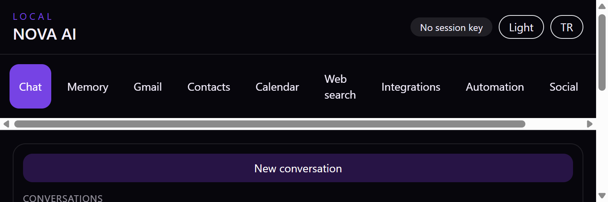

# NOVA — yerel kişisel asistan

NOVA, bu bilgisayarda çalışan bir FastAPI servisi, Ollama modelleri ve yerel PostgreSQL hafızası kullanır. Ayrıntılı kilometre taşları `PLAN.md` içindedir.

## Arayüz

Masaüstü uygulaması `http://127.0.0.1:4173` adresinde açılır.




## Şu an çalışanlar

- `GET /health`, `POST /chat` (`session_id` isteğe bağlıdır; mobil istemci yalnız `message` gönderebilir)
- API anahtarı: `X-API-Key`
- Ollama sohbeti, kısa süreli konuşma geçmişi ve `nomic-embed-text` gömüleri
- Uzun süreli hafıza: kaydet, ara, düzenle, sil, kategori, benzerlik eşiği, kopya tespiti ve kişisel bilgi için açık onay
- Salt okunur Gmail: arama, sayfalama, tam metin, ek bilgisi ve yanıt taslağı
- Kişiler ve takvim okuma uçları; değişiklik yalnız `onaylıyorum <kod>` ile ve yazma izni varken
- Web araması (`duckduckgo`, `searxng` veya `disabled`) ve kaynak adresleri
- Yerel masaüstü arayüzü (`desktop`) ve `X-API-Key` kullanan Expo mobil istemci
- Bas-konuş ses: çok dilli yerel Whisper ve durdurulabilir seslendirme
- Onay bekleyen yerel otomasyonlar; süre dolunca araç kendiliğinden çalışmaz

Resmi sosyal bağdaştırıcılar Telegram Bot API, WhatsApp Business Cloud API ve Instagram Messaging API ile sınırlıdır. Kişisel hesap istemcisi yoktur. Gönderim açık onay ister. Windows paketi `desktop/release/NOVA AI 1.0.0.exe` dosyasıdır ve imzasızdır. Çok dilli Whisper taban modeli kuruludur. Kişiler ile takvim, ayrı OAuth izni verilmeden canlı veri döndürmez.

Başlangıç: `QUICK_START.md`. Güvenlik: `SECURITY.md`. Elle test: `MANUAL_TESTS.md`. Son durum: `FINAL_REPORT.md`.

## Backend

```bash
cd backend
python -m venv .venv
.venv\Scripts\activate
pip install -r requirements.txt
copy .env.example .env
```

`.env` içine kendi yerel değerlerinizi yazın. Örnek dosyadaki `USER`, `PASSWORD` ve `replace-with-a-long-random-local-key` yer tutucudur. Servisi yalnız yerel arabirimde başlatın:

```bash
python -m uvicorn app.main:app --host 127.0.0.1 --port 8001 --reload
```

Belgeler: `http://127.0.0.1:8001/docs`. İsteklere `X-API-Key` ekleyin.

Kontroller:

```bash
python -m pytest tests -q
```

## Veri

Anlamsal hafıza yerel pgvector veritabanındadır. Yeni kurulum şeması `backend/app/db/schema.sql`, mevcut veritabanına eklenen sütunlar `backend/app/db/migrate.sql` dosyasındadır. Bu dosyalar satır silmez. Hacmi yeniden oluşturmayın.

Web araması `WEB_SEARCH_PROVIDER` ile seçilir: `duckduckgo`, `searxng` veya `disabled`. SearxNG için `WEB_SEARCH_BASE_URL` yerel adres olabilir. Benzerlik eşiği `MEMORY_MAX_DISTANCE`, kopya eşiği `MEMORY_DUPLICATE_DISTANCE` değeridir. Konuşma tanıma `VOICE_STT_PROVIDER=whisper` ve `voice/transcribe_wav.py` ile bağlıdır. Sürekli dinleme yoktur. 16 GB bellek için sohbet bağlamı 4096, üretim 400 belirteç ve 8 iş parçacığı ile sınırlıdır. Whisper CPU üzerinde 4 iş parçacığı kullanır.

## Masaüstü

```bash
cd desktop
npm install
npm run dev
```

Geliştirme arayüzü `http://127.0.0.1:5173` adresindedir. Paket `npm run pack:win` ile üretilir ve arayüzü `http://127.0.0.1:4173` üzerinden açar. API adresi varsayılan olarak `http://127.0.0.1:8001` olur. Anahtar yalnızca sekme oturumunda tutulur. CORS bu iki yerel kaynağa açıktır. Günlük başlatma `START_NOVA.bat` veya masaüstündeki `NOVA AI` kısayoludur.

`docker-compose.yml` ve `compose.yaml` farklı tanımlardır. Çalışan konteyneri bu dosyalardan yeniden oluşturmayın.

## Mobil

`mobile` Expo uygulamasıdır. API adresi ve `X-API-Key` Expo SecureStore içindedir. Sohbet gövdesi `{message, session_id}` gönderir; `session_id` olmadan da sunucu yanıtlar.

Uzak erişim kapalıdır. Telefon, `127.0.0.1` adresine ulaşamaz. Tailscale bu bilgisayarda kurulu değildir. Kurulursa FastAPI `tailscale serve` ile yalnız tailnet’e açılır ve PostgreSQL `127.0.0.1:5434` üzerinde kalır. Servisi `0.0.0.0` adresine bağlamayın ve veritabanı portunu yayınlamayın.

Android önkoşulları duruyor: Java 17 ve yerel Android SDK. `ANDROID_HOME` tanımsızdır ve `adb` PATH üzerinde değildir. APK bu turda üretilmedi. iOS derlemesi macOS ve Xcode ister. Telefon mikrofonu m4a üretir; yerel Whisper bunu kabul etmez.

## Güvenlik

`.env`, `credentials.json`, `token.json`, `token_contacts.json`, `token_calendar.json` ve veritabanı dökümlerini repoya koymayın. Servisi internete açmayın. Gmail kapsamı salt okunurdur. E-posta gönderme yoktur. Kişi veya takvim değiştirmek için önce açık onay, takvim yazmak için ayrıca OAuth izni gerekir.
