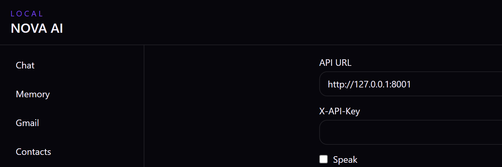

# NOVA — local personal assistant

**Status: in progress.** This repository is not a finished release. Development is still underway. The code and screenshots here show the point reached so far.

NOVA runs on this computer through a FastAPI service, Ollama models, and a local PostgreSQL memory store. Milestone details are in `PLAN.md`.

The interface defaults to English. Chat still follows the language of each message: Turkish in, Turkish out; English in, English out.

## Interface

The desktop app opens at `http://127.0.0.1:4173`.




## What works now

- `GET /health` and `POST /chat` (`session_id` is optional; the mobile client can send only `message`)
- API key: `X-API-Key`
- Ollama chat, short-term conversation history, and `nomic-embed-text` embeddings
- Long-term memory: save, search, edit, delete, categories, a similarity threshold, duplicate detection, and explicit consent for personal information
- Read-only Gmail: search, pagination, full text, attachment metadata, and a reply draft
- Contacts and calendar read endpoints; a change happens only with `onaylıyorum <code>` or `confirm <code>`, and only when write permission exists
- Web search (`duckduckgo`, `searxng`, or `disabled`) with source URLs
- A local desktop interface (`desktop`) and an Expo mobile client that uses `X-API-Key`
- Push-to-talk: multilingual local Whisper and speech that can be stopped
- Local automations that wait for confirmation; a tool does not run by itself when a timer expires

Official social adapters are limited to the Telegram Bot API, the WhatsApp Business Cloud API, and the Instagram Messaging API. There is no personal-account client. Sending requires explicit confirmation. The Windows package is `desktop/release/NOVA AI 1.0.0.exe` and is unsigned. The multilingual Whisper base model is installed. Contacts and calendar do not return live data until a separate OAuth grant is given.

Start here: `QUICK_START.md`. Security: `SECURITY.md`. Manual tests: `MANUAL_TESTS.md`. Latest recorded status: `FINAL_REPORT.md`.

## Backend

```bash
cd backend
python -m venv .venv
.venv\Scripts\activate
pip install -r requirements.txt
copy .env.example .env
```

Put your own local values in `.env`. `USER`, `PASSWORD`, and `replace-with-a-long-random-local-key` in the example file are placeholders. Start the service on the local interface:

```bash
python -m uvicorn app.main:app --host 127.0.0.1 --port 8001 --reload
```

Docs: `http://127.0.0.1:8001/docs`. Add `X-API-Key` to requests.

Checks:

```bash
python -m pytest tests -q
```

## Data

Semantic memory lives in a local pgvector database. The schema for a new install is `backend/app/db/schema.sql`. Columns added to an existing database are in `backend/app/db/migrate.sql`. These files do not delete rows. Do not recreate the volume.

Web search is selected with `WEB_SEARCH_PROVIDER`: `duckduckgo`, `searxng`, or `disabled`. For SearxNG, `WEB_SEARCH_BASE_URL` can be a local address. The similarity threshold is `MEMORY_MAX_DISTANCE`. The duplicate threshold is `MEMORY_DUPLICATE_DISTANCE`. Speech recognition is wired through `VOICE_STT_PROVIDER=whisper` and `voice/transcribe_wav.py`. There is no continuous listening. On a 16 GB machine the chat context is limited to 4096, generation to 400 tokens, and threads to 8. Whisper uses 4 CPU threads.

## Desktop

```bash
cd desktop
npm install
npm run dev
```

The development interface is at `http://127.0.0.1:5173`. `npm run pack:win` builds the package and serves the interface at `http://127.0.0.1:4173`. The API address defaults to `http://127.0.0.1:8001`. The key stays only in the tab session. CORS is open to these two local origins. Daily startup is `START_NOVA.bat` or the `NOVA AI` desktop shortcut.

`docker-compose.yml` and `compose.yaml` are different definitions. Do not recreate a running container from these files.

## Mobile

`mobile` is an Expo app. The API address and `X-API-Key` are stored in Expo SecureStore. The chat body sends `{message, session_id}`; the server also answers when `session_id` is omitted.

A phone cannot reach `127.0.0.1`. Tailscale on this computer is the private path for the phone. PostgreSQL stays on `127.0.0.1:5434`. Do not publish the database port.

Android builds need Java 17 and a local Android SDK. An iOS build needs macOS and Xcode. The phone microphone records M4A; local FFmpeg converts that before Whisper.

## Security

Do not commit `.env`, `credentials.json`, `token.json`, `token_contacts.json`, `token_calendar.json`, or database dumps. Do not expose the service to the internet. The Gmail scope is read-only. There is no email sending. Changing a contact or calendar event requires explicit confirmation first, and calendar writes also require a separate OAuth grant.
